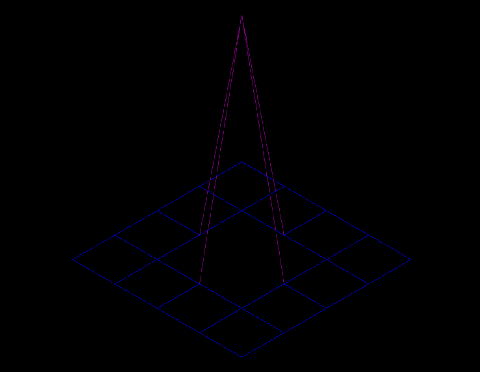

# FdF — Каркасная 3D-модель на Python

Программа для визуализации каркасных 3D-моделей в изометрической проекции.

## Скриншот



## Установка и запуск

```bash
python main.py maps/elem.fdf
## Проверки

Все тесты проходят:
- pytest: 16 passed
- mypy: no issues found
- ruff: all checks passed